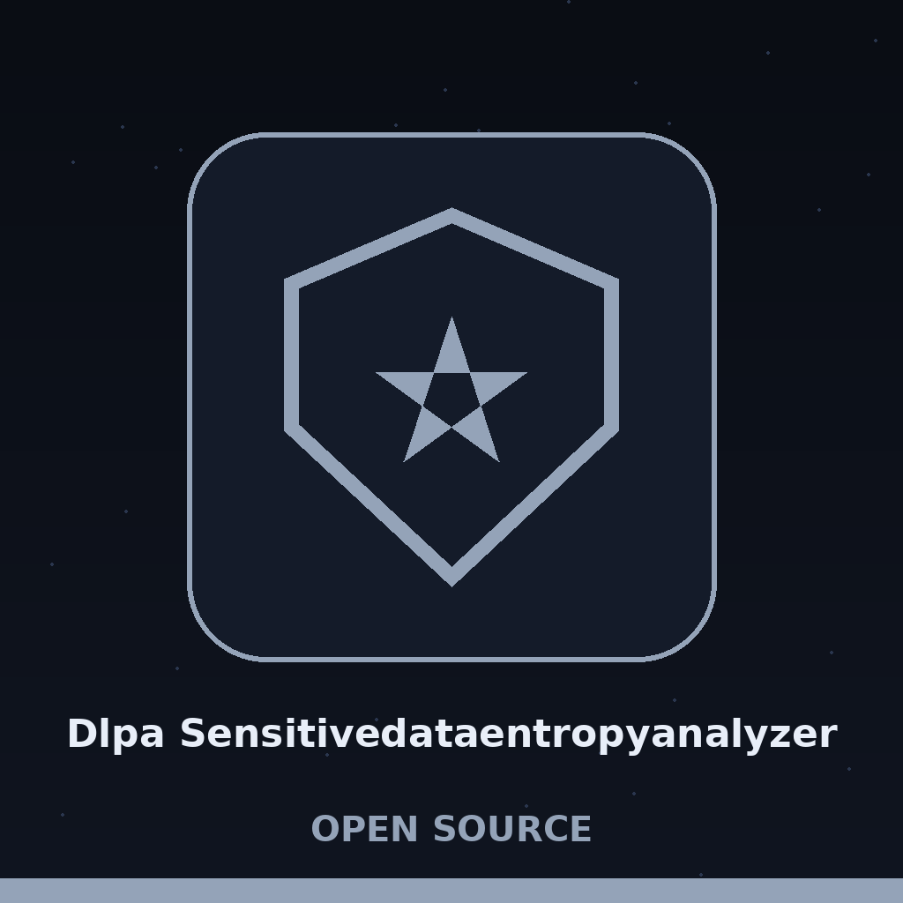

# dlpa-sensitivedataentropyanalyzer

Title block: the name above is set in Bree Serif in hive wood on a sky tinted board, in the manner of a garden sign, with a small pod at the left of the first heading only and plain ruled boards after that.

# dlpa-SensitiveDataEntropyAnalyzer
Calculates the entropy of files and directories to identify potential sensitive data based on high randomness, bypassing reliance on predefined keywords or patterns. Flags files exceeding an entropy threshold for further investigation. - Focused on Tools for assessing the effectiveness of data leakage prevention (DLP) measures. This involves generating realistic but fake sensitive data (e.g., credit card numbers, names, addresses) using Faker and then testing how well DLP systems detect and prevent the exfiltration of this data. Focus on validating DLP rules rather than building a full DLP system.

Note: generate mode (-g) needs no path argument. An analysis run without a path is an error.

## Install
`git clone https://github.com/ShadowGuard-AI/dlpa-sensitivedataentropyanalyzer`

## Usage
`python3 main.py [path] [options]`

> Bedside note: a flag changes no exit code, so read the log. A flagged file is a warning line in the log and nothing more, and the run still ends at 0.

## Parameters
- `path`: Path to the file or directory to analyze. Not required in generate mode (`-g`).
- `-h`: Show help message and exit
- `-t`, `--threshold`: Entropy threshold. Files exceeding this value will be flagged. Default: 4.5
- `-r`, `--recursive`: Recursively analyze directories.
- `-v`, `--verbose`: Enable verbose output (debug logging).
- `-g`, `--generate`: Generate fake sensitive data for DLP testing.
- `-n`, `--num-files`: Number of files to generate when using -g. Default: 10
- `-d`, `--output-dir`: Output directory for generated files. Default: fake_data

> Bedside note: analyse mode needs the Faker package installed before it can even start, because Faker is imported at the very top of main.py, so the help text depends on it too.

> Bedside note: the threshold is a strict line: above it flags, at it does not. A file is flagged only when its number is strictly above the threshold, never at it.

## License
This project is released under the MIT License. See the [LICENSE](LICENSE) file for details.

## Bedside notes, gathered at the bed end

The buttons of this re-skin read Weigh This File, Walk Every Bed, Sow a Test Batch, and Read the Bed Plan. Its headings read One Number per File, Above the Line Means Flagged, Nothing Is Written but the Log, The Second Job Sows Records, and Two Exits Worth Knowing. Identity tally for the preserved text above: the hyphenated org name appears 1 time, in the install line, and it is correct. No other org spelling appears in the preserved text. The title heading restyles the repo name as dlpa-SensitiveDataEntropyAnalyzer, with capitals the repo itself does not use; that fault is preserved above and flagged here, not silently fixed. One correction is applied in the opening above: it formerly spoke of structured formats, and the code checks none, so that phrase was removed in this wave. The website carries the same correction, labelled as a correction.
